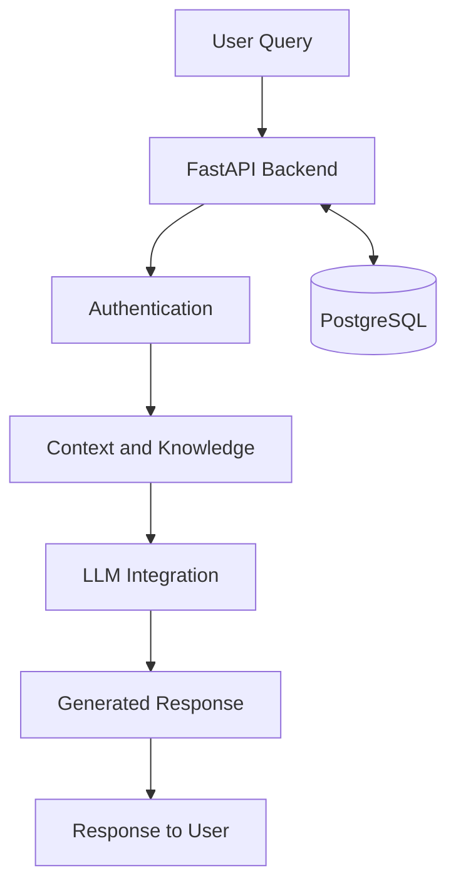

# 🤖 TMM AI Chatbot
### Context-Aware Conversational AI | LLMs | Python | FastAPI

An AI-powered chatbot project designed to answer application-specific questions using contextual information and Large Language Models (LLMs).

The project focuses on building a useful conversational experience by combining AI-generated responses with backend APIs, conversation history, and structured application knowledge.

## 🚀 Project Highlights

- **Context-Aware Responses:** Uses application-specific context to help generate relevant answers.
- **LLM Integration:** Connects an LLM to conversational application workflows.
- **Backend API Development:** Uses FastAPI to expose chatbot functionality through REST endpoints.
- **Conversation History:** Supports storing and retrieving chat messages using PostgreSQL.
- **Authentication:** Protects chatbot endpoints using token-based authentication.
- **Knowledge-Grounded Responses:** Uses application knowledge and retrieval workflows where configured.
- **Response Quality:** Emphasizes testing, relevance, and reliable chatbot behavior.

## 🏗️ Architecture Overview



*Conceptual architecture; adjust the diagram to match the actual implementation.*

## 🛠️ Technology Stack

| Category | Technologies |
|---|---|
| Language | Python |
| Backend | FastAPI |
| AI | Large Language Models, OpenAI API |
| Database | PostgreSQL |
| ORM | SQLAlchemy |
| API | REST APIs |
| Containerization | Docker |

## 🔄 How It Works

1. A user submits a question to the chatbot.
2. The backend validates the request and authentication.
3. Relevant application context is prepared for the AI workflow.
4. The LLM generates a response based on the available context and instructions.
5. Conversation messages are persisted in the database.
6. The response is returned to the user.

*The exact workflow depends on the configured retrieval, tool-calling, and persistence logic.*

## 💡 Engineering Focus

This project explores practical challenges in building LLM-powered applications:

- Managing application context and conversation history.
- Integrating AI models with backend services.
- Designing clear API boundaries.
- Improving answer relevance and reliability.
- Handling authentication, errors, and database operations.
- Evaluating response quality and application performance.

## ⚙️ Getting Started

### Prerequisites

- Python 3.10 or a compatible version specified by the project
- PostgreSQL
- An LLM API key, if required by your configuration
- Git

### Installation

Clone the repository:

```bash
git clone https://github.com/Premyarramreddy/tmm_chat_bot.git
cd tmm_chat_bot
```

Create and activate a virtual environment:

```bash
python -m venv .venv
```

Install dependencies using the dependency file provided in the repository. For example, if the project contains `requirements.txt`:

```bash
pip install -r requirements.txt
```

Configure the required environment variables using the project's environment configuration or `.env.example` file.

Start the application using the actual FastAPI entry point configured in the project. For example:

```bash
uvicorn app.main:app --reload
```

If the application uses a different module path, replace `app.main:app` with the correct entry point.

## 🔐 Configuration and Security

- Keep API keys, database credentials, and JWT secrets in environment variables.
- Never commit `.env` files containing real credentials.
- Use `.env.example` with placeholder values for required settings.
- Do not publish private customer information, internal documentation, or production tokens.

## 🧪 Testing and Evaluation

Recommended validation areas include:

- API endpoint behavior and error handling.
- Authentication and access control.
- Context relevance and answer faithfulness.
- Conversation history persistence.
- Response latency and failure handling.

Add test commands and measured evaluation results after validating them against the implementation.

## 🎯 Future Improvements

Potential areas for further development:

- Improved retrieval and document chunking.
- Structured LLM evaluation and regression testing.
- AI agent workflows and tool calling.
- Request tracing, monitoring, and structured logging.
- Automated testing and continuous integration.

## 👨‍💻 Project

**Repository:** [tmm_chat_bot](https://github.com/Premyarramreddy/tmm_chat_bot)

Developed as a practical exploration of Generative AI, conversational applications, and backend engineering.

---

**Note:** Confirm project ownership, employer permission, and applicable licensing before publishing source code or implementation details publicly.
